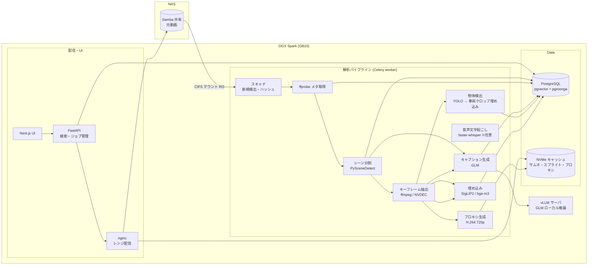

# VideoExplore 設計検討書

動画ライブラリのセマンティック検索 + 車両画像検索 + 即再生 Web システム

作成日: 2026-08-30
前提環境: DGX Spark クラス (NVIDIA GB10 / ユニファイドメモリ 128GB)、Docker / Docker Compose、Python 3.12、動画は Samba (SMB) 上に数千〜数万本、長さは混在

---

## 1. 目的と要件整理

| # | 要件 | 実現方針 |
|---|------|----------|
| 1 | 大量の動画を GLM(マルチモーダル)で解析しテキスト化して DB 化 | ローカル vLLM で GLM を推論。シーン分割 + キーフレーム抽出 → 説明文・タグ生成 |
| 2 | 「影のシーン」等の自然言語で検索し、ヒットしたシーンへ即ジャンプ再生 | 説明文の全文検索 + ベクトル検索のハイブリッド。結果はシーン単位のサムネイル、クリックでその時刻から再生 |
| 3 | 画像を与えて「この車両を全動画から探す」 | フレーム内の車両を検出(YOLO)→ 切り抜きを埋め込み化 → クエリ画像との類似検索 |
| 4 | 動画アクセスは Samba 経由 | CIFS マウントで読み取り専用参照。再生用ストリーミング + ローカル NVMe にプロキシキャッシュ |
| 5 | ローカル推論(画像を外部送信しない) | GLM・埋め込み・検出モデルはすべてローカル GPU で実行。API フォールバックは設定で任意 |

### スコープ外(今回は触れない)
- 動画の編集・書き込み(参照は読み取り専用)
- ユーザー管理・認証(必要になった段階で簡易認証を追加)

---

## 2. 全体アーキテクチャ



ポイント:

- **解析はすべてバックグラウンドジョブ**。取り込み中でも既解析済みの動画は検索・再生可能。
- **段階的に「検索可能」になる**:メタ取得 → シーン分割 → 埋め込み(高速)で先に検索対象にし、GLM の説明文生成(低速)は後追いで充実させていく。
- 元動画は **絶対に書き換えない**。派生物(サムネ・スプライト・プロキシ・埋め込み)はローカル NVMe のキャッシュ領域に置き、LRU で退避。

---

## 3. 技術選定

| 領域 | 採用 | 理由 / 備考 |
|------|------|-------------|
| Web フレームワーク | FastAPI (Python 3.12) | 非同期・OpenAPI 自動生成・AI 周辺資産が豊富 |
| フロントエンド | Next.js (React) + TypeScript | 検索 UI・プレイヤー・タイムラインを型安全に構築 |
| DB | PostgreSQL 17 + **pgvector** (HNSW) | 埋め込みベクトル検索。数百万フレーム規模まで実績あり |
| 日本語全文検索 | **pgroonga** | 日本語をトークナイズ不要で高速検索。Docker イメージで導入容易 |
| あいまい検索 | pg_trgm | 誤字・部分一致の補完 |
| タスクキュー | Redis + Celery | 優先度キュー・リトライ・再開(ステートマシン)に対応 |
| VLM | **GLM** (ローカル vLLM 推論) | モデル名は設定で変更可。GB10 の 128GB ユニファイドメモリに MoE 版を量子化(FP4/FP8)で載せる。メモリ不足時は API へ設定切替 |
| 画像・テキスト埋め込み | **SigLIP2**(フレーム画像) / **bge-m3**(説明文・日本語クエリ) | SigLIP2 は画像↔画像・英語テキスト↔画像。日本語クエリは GLM が英訳してから SigLIP2 へ投げる二段構え。説明文検索は bge-m3 で多言語セマンティック検索 |
| 物体検出 | YOLO 系 (vehicle クラス) | フレームから車両を検出しクロップを埋め込み化 |
| 音声認識(任意) | faster-whisper | 録画系で「発話で検索」をしたい場合に追加 |
| 動画処理 | ffmpeg (+ NVDEC/NVENC) | サムネ・スプライト・プロキシ生成。H.265 もハードウェアデコード |
| 配信 | nginx(レンジリクエスト対応) | SMB マウントとキャッシュを直接配信。FastAPI の負荷を分離 |
| 実行環境 | Docker Compose | GPU・DB・Web を一括管理 |

---

## 4. 動画取り込みパイプライン

### 4.1 流れ(動画 1 本あたりのステートマシン)

```
discovered → probed → scene_detected → frames_extracted
           → embedded → detected(車両) → captioned → ready
                    └→ proxy_generated(並行)
```

- 各ステップは冪等(再実行安全)。中断・再開・部分失敗に強い。
- `videos.status` で進捗を UI に表示(「解析中 60%」「検索可能」「エラー」)。

### 4.2 サンプリング設計(長さ混在への対応)

長さに応じて解析密度を自動調整する **3 段階プロファイル**:

| プロファイル | シーン分割後のキーフレーム | 用途 |
|---|---|---|
| Fast(デフォルト) | シーン先頭 1 枚 / シーンあたり最大 3 枚 | 全体を最短で検索可能にする |
| Standard | シーン内 5〜10 秒間隔 | 通常運用 |
| Detailed(重要動画のみ) | 2 秒間隔 + 音声 + OCR | 重点調査対象 |

- 埋め込み対象フレームは全プロファイル共通で **秒間 1 枚相当** を上限にサンプリング(検索粒度の担保)。
- GLM に渡すのはキーフレームのみ(コストの大半がここ)。プロファイルは動画単位・フォルダ単位で上書き可能。

### 4.3 GLM への指示(1 シーン 1 コール)

キーフレーム(1〜3 枚)を渡し、構造化 JSON で取得:

```json
{
  "description_ja": "夕暮れの駐車場で黒いセダンが影の中に停まっている",
  "description_en": "A black sedan parked in shadow at dusk in a parking lot",
  "tags": ["影", "逆光", "車両", "セダン", "夕方", "駐車場"],
  "objects": [{"class": "car", "attributes": ["black", "sedan"]}],
  "time_of_day": "dusk", "weather": "clear", "camera_motion": "static"
}
```

- **管理語彙(タクソノミ)テーブル** を用意し、タグはそこへ正規化。「影 ↔ シャドウ ↔ 日陰」の同義語辞書で検索漏れを防ぐ。
- GLM が生成した `description_en` を SigLIP2 のテキストエンコーダにも渡しておき、**テキスト→画像** のベクトル検索インデックスを作る(日英両対応の検索を実現)。

---

## 5. 検索機能設計

### 5.1 テキスト検索(例:「影のシーン」)

ハイブリッド検索 → リランキング:

1. **全文検索**:pgroonga で `description_ja` / `tags` / `transcripts` を検索(語一致・部分一致)
2. **セマンティック検索**:クエリを bge-m3 で埋め込み、シーン説明ベクトルとコサイン類似 KNN(HNSW)
3. **フレーム検索**:クエリ(GLM で英訳 + キーワード展開)を SigLIP2 テキスト側でエンコードし、フレーム埋め込みと KNN
4. **リランキング**:スコア正規化して統合、動画単位でグルーピング(同一動画の連続シーンをまとめる)

返却:シーン単位のサムネイル + 開始時刻 + 説明 + タグ + スコア。クリックで **そのシーンの開始時刻から即再生**。

フィルタ:期間(撮影日時)、フォルダ、長さ、解像度、タグ、カメラ情報等。

### 5.2 画像検索(例:「この車両を探して」)

2 段階(粗 → 精):

1. **検出(取り込み時)**:全サンプリングフレームに YOLO を実行 → 車両バウンディングボックスをクロップ → SigLIP2 で埋め込み → `detections` テーブルに (video_id, ts, bbox, crop, vector) を保存
2. **クエリ時**:
   - アップロード画像から YOLO で車両を検出・クロップ → 埋め込み
   - pgvector HNSW で `detections` と KNN → 上位 N 件
   - **再ランク**:上位候補のクロップ画像同士でより高精度な類似度(色ヒストグラム + 別モデル埋め込み)を計算し精緻化
3. UI:類似度スライダで閾値調整、バウンディングボックス付きサムネイル表示、クリックで該当時刻から再生、同一動画内の複数ヒットは時系列でグループ表示

**限界と対策**:

| 限界 | 対策 |
|------|------|
| 外観が似た別車両もヒットする(真の個体識別は困難) | 再ランク強化 / スライダで閾値調整 / 誤ヒット「×」ボタンでクエリ側から除外するフィードバック |
| 撮影角度・距離差で埋め込みが乱れる | 複数フレームからのクロップを蓄積しているため、角度違いの候補もヒットする。ナンバー OCR は将来オプション |
| サンプリング間隔の間に見逃しがある | 重要検索時のみ対象動画を 1 fps で再走査する「詳細スキャン」モードを用意 |

---

## 6. Samba アクセスと再生

### 6.1 マウント方針

- ホストで `mount -t cifs` により **読み取り専用** マウント(例: `/mnt/videos`)。
  - `vers=3.1.1, ro, cred=/etc/videoexplore/smb.cred, iocharset=utf8`
  - 資格情報は Docker secrets / env ファイルで管理(リポジトリに入れない)
- コンテナには bind mount で RO 参照させる。
- 代替案: `rclone mount --read-only`(SMB バックエンド)。カーネル CIFS が使えない環境でのフォールバック。

### 6.2 再生の課題と解決

| 課題 | 解決策 |
|------|--------|
| SMB 越しのシークが遅い・引っ掛かる | **プロキシ生成**:取り込み時に 720p H.264 + AAC(faststart)を NVMe キャッシュに作成。再生・シークはプロキシ経由。LRU で容量管理(例: 200GB 上限) |
| 監視カメラ系の H.265 はブラウザが再生できない | プロキシを H.264 にトランスコードすることで必ず再生可能に。元動画は直接ブラウザへ出さない |
| moov atom が末尾の MP4 で即再生できない | faststart 付きプロキシで解消 |
| シークバーのプレビューが欲しい | **スプライトシート**(例: 10 秒間隔 160px)を生成し、シーク中にプレビュー表示 |
| 長時間動画のタイムライン | シーン区切り + 検出マーカーをタイムラインに重ねて表示 |

配信は nginx が `Range` リクエストに対応して SMB マウント(プロキシ未生成時のフォールバック)とキャッシュを配信。プレイヤーは `<video>` + スプライトプレビュー + `?t=` ディープリンク対応。

---

## 7. DB スキーマ案(主要テーブル)

```sql
CREATE EXTENSION IF NOT EXISTS vector;
CREATE EXTENSION IF NOT EXISTS pgroonga;

CREATE TABLE videos (
  id            BIGSERIAL PRIMARY KEY,
  path          TEXT UNIQUE NOT NULL,          -- SMB 上の相対パス
  sha256        TEXT,                          -- 重複検出用
  size_bytes    BIGINT, duration_sec REAL,
  width INT, height INT, fps REAL, codec TEXT,
  mtime TIMESTAMPTZ, shot_at TIMESTAMPTZ,      -- 撮影日時(EXIF/メタ/ファイル名推定)
  status        TEXT NOT NULL DEFAULT 'discovered',
  error         TEXT,
  thumbnail_path TEXT, sprite_path TEXT, proxy_path TEXT,
  proxy_status  TEXT DEFAULT 'pending',
  profile       TEXT DEFAULT 'fast',           -- 解析プロファイル
  created_at    TIMESTAMPTZ DEFAULT now(),
  updated_at    TIMESTAMPTZ DEFAULT now()
);

CREATE TABLE scenes (
  id            BIGSERIAL PRIMARY KEY,
  video_id      BIGINT REFERENCES videos ON DELETE CASCADE,
  start_sec REAL, end_sec REAL,
  keyframe_path TEXT,
  description_ja TEXT, description_en TEXT,
  tags          TEXT[] DEFAULT '{}',
  tsv           TSVECTOR,                      -- pgroonga 用(pgroonga はテキスト直接も可)
  vec_text      VECTOR(1024),                  -- bge-m3(description_ja/en)
  created_at    TIMESTAMPTZ DEFAULT now()
);
CREATE INDEX idx_scenes_vec ON scenes USING hnsw (vec_text vector_cosine_ops);
CREATE INDEX idx_scenes_fulltext ON scenes USING pgroonga (description_ja, description_en);
CREATE INDEX idx_scenes_tags ON scenes USING gin (tags);

CREATE TABLE frames (
  id         BIGSERIAL PRIMARY KEY,
  video_id   BIGINT REFERENCES videos ON DELETE CASCADE,
  scene_id   BIGINT REFERENCES scenes,
  ts_sec     REAL NOT NULL,
  path       TEXT,                              -- 抽出フレームのキャッシュパス
  vec_img    VECTOR(1152)                       -- SigLIP2
);
CREATE INDEX idx_frames_vec ON frames USING hnsw (vec_img vector_cosine_ops);

CREATE TABLE detections (                       -- 車両等のクロップ
  id         BIGSERIAL PRIMARY KEY,
  video_id   BIGINT REFERENCES videos ON DELETE CASCADE,
  frame_id   BIGINT REFERENCES frames,
  ts_sec     REAL NOT NULL,
  cls        TEXT,                              -- car / truck / bus / motorcycle ...
  score      REAL,
  bbox       REAL[4],                           -- x1,y1,x2,y2 (正規化)
  crop_path  TEXT,
  vec        VECTOR(1152)                       -- SigLIP2(crop)
);
CREATE INDEX idx_det_vec ON detections USING hnsw (vec vector_cosine_ops);

CREATE TABLE transcripts (                      -- 任意(音声)
  id BIGSERIAL PRIMARY KEY,
  video_id BIGINT REFERENCES videos ON DELETE CASCADE,
  start_sec REAL, end_sec REAL, text TEXT
);

CREATE TABLE taxonomy (                          -- 管理語彙・同義語
  tag TEXT PRIMARY KEY, aliases TEXT[], category TEXT
);

CREATE TABLE jobs (                              -- パイプライン進捗
  id BIGSERIAL PRIMARY KEY, video_id BIGINT, stage TEXT,
  state TEXT, priority INT DEFAULT 5, detail JSONB,
  updated_at TIMESTAMPTZ DEFAULT now()
);
```

容量目安:フレーム 100 万枚 × 1152 次元(fp16)≈ **2.5GB**。数万本規模で十分現実的。

---

## 8. 処理時間の目安(GB10 概算)

前提例:**5,000 本 × 平均 10 分 = 約 833 時間**、フレーム 10 秒間隔サンプリング ≈ 30 万枚、シーン数 ≈ 6 万。

| ステージ | スループット目安 | 所要時間(概算) |
|---|---|---|
| SMB 読み取り + ハッシュ | NAS 帯域次第(1GbE ≈ 110MB/s) | 元データ 1TB なら約 2.5h(複数回読むため注意) |
| ffprobe / メタ | 高速 | 数十分 |
| シーン検出 (PySceneDetect, 縮小フレーム) | 実時間の 5〜15 倍速 | 1〜3h |
| フレーム抽出 + SigLIP2 埋め込み | 30〜100 枚/秒 | 1〜3h |
| YOLO 車両検出 | 30〜80 fps | 数時間 |
| **GLM キャプション(Fast)** | 約 5〜8 秒/キーフレーム | **6 万シーンで約 4〜5 日**(バックグラウンド) |
| プロキシ生成 (720p H.264 NVENC) | 実時間の 4〜8 倍速 | 数日(容量 LRU のため部分生成も可) |

**対策(設計に織り込み済み)**:

1. 埋め込み完了時点で「検索可能」にし、説明文は後から入る(検索体験は即日開始できる)
2. 優先度キュー:選択フォルダ・新着動画を先に処理
3. GLM が追いつかない場合、設定切替で **API に一時フォールバック**(自動でローカルに戻す)も可能
4. 処理進捗・スループットをダッシュボード表示

---

## 9. リポジトリ構成とサービス構成

```
VideoExplore/
├─ docker-compose.yml
├─ .env.example              # SMB 認証・モデル名・パス等
├─ backend/
│  ├─ app/                   # FastAPI(検索 API・ジョブ API・配信 API)
│  │  ├─ main.py  routers/  services/
│  ├─ worker/                # Celery タスク群
│  │  ├─ tasks/ (scan, probe, scene, frames, embed, detect, caption, proxy)
│  │  └─ pipelines.py
│  ├─ models/                # 埋め込み・YOLO ラッパ
│  └─ pyproject.toml
├─ frontend/                 # Next.js(検索・画像検索・ライブラリ・詳細・設定)
├─ db/init/                  # スキーマ・pgroonga 設定
├─ nginx/nginx.conf          # レンジ配信・キャッシュ
└─ scripts/                  # mount_smb.sh, bench_*.sh, backfill.py
```

Compose サービス:`db`(pgvector+pgroonga)/ `redis` / `api` / `worker-gpu` / `vllm` / `web`(Next.js)/ `nginx`(配信)。

### 画面構成

1. **検索**:テキストボックス + タグチップ + フィルタ → シーンカードグリッド(サムネ・時刻・スコア)→ クリックで即再生
2. **画像検索**:画像ドロップ → 車領域の自動クロップ確認 → 類似度スライダ → ヒット一覧(バウンディングボックス付き、動画・時刻)
3. **ライブラリ**:動画一覧(解析状態インジケータ)、フォルダツリー、手動「解析する/優先」
4. **詳細**:プレイヤー(シークプレビュー、シーン/検出マーカー付きタイムライン、キーボード操作)
5. **設定**:SMB パス、解析プロファイル、GLM モデル切替(ローカル/API)、キャッシュ上限、ダッシュボード

---

## 10. 実装フェーズ

| フェーズ | 内容 | 完了基準 |
|---|---|---|
| **P0: 基盤 PoC**(〜1 週) | SMB マウント、スキャン・メタ取得、DB スキーマ、nginx レンジ配信、Next.js で一覧 + 即再生 | サンプル動画 50 本が一覧・再生できる |
| **P1: 解析パイプライン**(1〜2 週) | シーン分割・キーフレーム・SigLIP2 埋め込み・ハイブリッド検索 | 「影のシーン」でシーン単位ヒット + ジャンプ再生 |
| **P2: 車両画像検索**(1 週) | YOLO 検出・クロップ埋め込み・画像クエリ UI・再ランク | クエリ画像で該当車両のシーンが上位ヒット |
| **P3: GLM キャプション**(1〜2 週) | vLLM セットアップ・構造化キャプション・タクソノミ・タグ検索強化 | 日本語説明・タグで検索精度が明確に向上 |
| **P4: 運用仕上げ**(1 週) | プロキシ/スプライト、優先度キュー、ダッシュボード、API フォールバック、LRU キャッシュ | 数千本を連続投入して安定稼働 |
| **P5: 拡張(任意)** | 音声文字起こし、詳細スキャン(1fps 再走査)、フィードバック学習 | 要望に応じて |

---

## 11. リスクと対策まとめ

| リスク | 影響 | 対策 |
|---|---|---|
| GLM ローカルのスループット不足(数万本) | 解析滞留 | Fast/Standard/Detailed の段階解析、優先度キュー、API フォールバック |
| SMB 帯域・遅延 | 取り込み・再生が遅い | プロキシキャッシュ、ハッシュ計算は初回のみ、夜間バッチ |
| H.265 等ブラウザ非対応コーデック | 再生不可 | プロキシを必ず H.264 で生成 |
| 同一車両の識別精度限界 | 誤ヒット | 再ランク、閾値 UI、除外フィードバック、詳細スキャン |
| 日本語検索の漏れ | 検索漏れ | pgroonga + 同義語辞書 + ベクトル検索の併用 |
| キャッシュ容量(239GB 空き) | ディスク圧迫 | LRU 退避、上限設定、派生物のみキャッシュ |
| 大量ジョブの失敗混在 | 全体停止 | 冪等ステップ + ステートマシン + 自動リトライ + エラー隔離 |

---

## 12. 未決事項(実装開始前に確認)

1. SMB 共有のアドレス・認証方式(ドメイン/ゲスト)、マウント先パス
2. 動画のcodec・コンテナ分布(調査スクリプトで P0 時に実測)
3. GLM の想定バリエーション(ローカルで載る量子化版の選定 or API 契約の有無)
4. 「車両検索」の精度要求(似た車でよいか、個体特定まで必要か → ナンバー OCR の要否)
5. 撮影日時の把握方法(EXIF / ファイル名規則 / パス構造)
6. 同時アクセス人数(配信帯域設計に影響)
